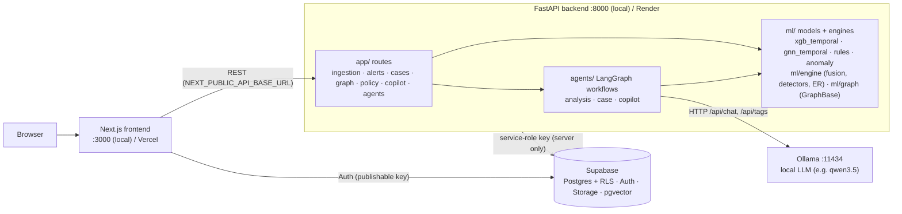

# TraceLayer (TrojanHacks 2026)

Governed financial-crime investigation layer: data quality and lineage → risk models and typology rules →
money-flow graph → multi-agent case copilot (local LLM) → human review and audit trail.
Spec: `docs/TraceLayer_PRD_v3_3_Implementation_Playbook.docx`.

| folder | what | runs as |
|---|---|---|
| `frontend/` | Next.js 16 investigation UI | `next dev` on :3000 |
| `backend/` | FastAPI API (`app/`), ML models and engines (`ml/`) | `uvicorn` on :8000 |
| `agents/` | LangGraph multi-agent workflows (`tracelayer_agents`); see [integration guide](agents/docs/INTEGRATION.md) | imported **in-process** by the backend (`-e ../agents`), not a separate server |
| `supabase/` | Postgres schema, RLS, storage, pgvector migrations | hosted Supabase project |
| `docs/` | PRD | — |

## Architecture



- **LLM path**: only `agents/tracelayer_agents/llm/client.py` calls a model, and only Ollama (`OLLAMA_HOST`).
  Output is schema-validated JSON; if Ollama is down, slow or returns invalid output, a deterministic
  template answers and the receipt says `fallback_used=true`. No cloud LLM is called. `LLM_PROVIDER=template`
  runs with no LLM at all.
- **Agents**: `analysis` (ingest → features → detectors → aggregate → investigate flows), `case`
  (load case → retrieve policy → draft narrative → verify → human decision → record), `copilot`
  (case-scoped Q&A). Details: `agents/docs/ARCHITECTURE.md`, `agents/docs/CONTRACTS.md`.
- **Secrets**: the Supabase service-role key and `SERVICE_API_KEY` live only in `backend/.env` (or the host's
  env). The frontend gets only public `NEXT_PUBLIC_*` values.

## Run locally (full stack)

Prerequisites: Python 3.11, Node 20+, [Ollama](https://ollama.com/download), a Supabase project.

**1. Supabase (once).** Apply every migration in `supabase/migrations/` in filename order, either with the CLI
(`supabase link --project-ref <ref> && supabase db push`) or by pasting each file into the SQL editor. The agent
workflows need `20261018000004_agent_orchestration.sql`.

**2. Ollama (terminal 1).**

```bash
ollama serve                         # :11434; skip if the desktop app is already running
ollama pull qwen3.5:9b               # or a smaller model on a laptop, e.g. qwen3.5:0.8b
ollama list                          # the model you put in OLLAMA_MODEL must appear here
```

**3. Backend (terminal 2).** Installs the API, the ML stack and the `agents/` package (editable).

```bash
cd backend
python3.11 -m venv .venv && source .venv/bin/activate
pip install -r requirements.txt
cp .env.example .env                 # set SUPABASE_URL, SUPABASE_SERVICE_ROLE_KEY, SERVICE_API_KEY,
                                     # LLM_PROVIDER=ollama, OLLAMA_MODEL=<an installed model>
uvicorn main:app --reload --port 8000
curl http://127.0.0.1:8000/health    # {"status":"ok"}; interactive API docs at http://127.0.0.1:8000/docs
```

**4. Frontend (terminal 3).**

```bash
cd frontend
npm install
cp .env.example .env.local           # NEXT_PUBLIC_API_BASE_URL=http://127.0.0.1:8000 + Supabase URL / publishable key
npm run dev                          # http://localhost:3000
```

**Checks.** `cd backend && pytest -q` (API, ML features, engine, graph) and
`cd agents && pip install -e '.[dev]' && pytest -q`. To run the agents with no LLM, set
`LLM_PROVIDER=template` in `backend/.env`.

## Deploy: Vercel (frontend) + Render (backend + Ollama)

Supabase stays the hosted database. Deploy the backend first, because the frontend needs its URL.

**1. Ollama on Render** (a Private Service, reachable only from the backend)
- New → Private Service → *Deploy an existing image* → `ollama/ollama:latest`.
- Add a persistent disk mounted at `/root/.ollama` (≥ 10 GB) so pulled models survive restarts.
- The model must fit in RAM: `qwen3.5:9b` needs roughly 8 GB or more. On smaller instances use a small model
  (e.g. `qwen3.5:0.8b`), or skip this service and set `LLM_PROVIDER=template` on the backend.
- After the first deploy, open the service Shell and run `ollama pull <model>`.
- Note its internal address, e.g. `http://tracelayer-ollama:11434`.

**2. Backend on Render** (Web Service, Python)
- Root Directory: **leave empty (repo root)**. The build needs `agents/` beside `backend/` for `-e ../agents`.
- Build Command: `cd backend && pip install -r requirements.txt`
- Start Command: `cd backend && uvicorn main:app --host 0.0.0.0 --port $PORT`
- Health Check Path: `/health`
- Environment: `PYTHON_VERSION=3.11.15`; every key from `backend/.env.example` with real values;
  `OLLAMA_HOST=<Ollama private URL from step 1>`, `OLLAMA_MODEL=<pulled model>`;
  `CORS_ORIGINS=["https://<your-app>.vercel.app"]` (fill in once step 3 gives you the URL).
- Instance: `torch`, `xgboost` and the model artifacts in `backend/ml/artifacts/` need ≥ 2 GB RAM. The free
  512 MB tier runs out of memory.

**3. Frontend on Vercel**
- New Project → import the repo → Root Directory: `frontend` (Next.js is auto-detected).
- Environment variables: `NEXT_PUBLIC_API_BASE_URL=https://<backend>.onrender.com`,
  `NEXT_PUBLIC_SUPABASE_URL`, `NEXT_PUBLIC_SUPABASE_PUBLISHABLE_KEY`. Never put the service-role key here.
- Deploy, then put the Vercel URL into the backend's `CORS_ORIGINS` on Render and redeploy the backend.

**4. Supabase**: add the Vercel URL under Authentication → URL Configuration (Site URL and redirect URLs).

## ML layout (`backend/ml/`)

| package | data | what |
|---|---|---|
| `ml/tracelayer/` | synthetic AMLSim-style (`ml/data/`, generated) | rules, Isolation Forest, XGBoost, GNN, ensemble; `TraceLayerScorer` serves them |
| `ml/ibm/` | IBM AML HI-Small (Kaggle) | XGBoost reproducing Shahbazi et al. 2026 (arXiv:2609.37155); strict time-respecting GATv2; `IBMScorer` serves the point-in-time `xgb_temporal` |
| `ml/engine/` | any canonical feed | PRD §5: alert fusion + priority policy, typology detectors, robust baselines, fuzzy entity resolution, run manifests |
| `ml/graph/` | any canonical feed | PRD §6 GraphBase engine: adapter, bounded cycles/motifs, metrics, snapshots, propagation |

Artifacts: `ml/artifacts/tracelayer/`, `ml/artifacts/ibm/`. Run from `backend/`:

```bash
python -m ml.tracelayer.generate_data --out ml/data
python -m ml.tracelayer.train --data ml/data --out ml/artifacts/tracelayer
python -m ml.tracelayer.scorer                    # self-check: serving PR-AUC == training

python -m ml.ibm.xgb --data <HI-Small dir> --out ml/artifacts/ibm   # or ml/ibm/colab_xgb.ipynb on Colab
python -m ml.ibm.scorer --data <HI-Small dir>     # self-check: serving AUPRC == Colab
python -m ml.ibm.gnn --data <HI-Small dir> --out ml/artifacts/ibm --temporal   # GPU recommended
```

IBM HI-Small test AUPRC: paper XGBoost 38.46; ours with the paper's config 38.05 ± 0.91 (a faithful
reproduction). Served, leakage-safe `xgb_temporal`: 44.92. Strict time-respecting GNN: 61.33 (paper GATv2
64.85); GNN + XGB ensemble: 62.41. Run-by-run ledger: `ml/artifacts/ibm/RUNS.md`; write-up: `RESULTS.md`.
