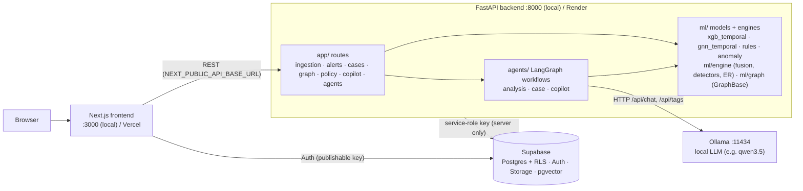

# TraceLayer (TrojanHacks 2026)

Governed financial-crime investigation layer: data quality and lineage → risk models and typology rules →
money-flow graph → multi-agent case copilot (local LLM) → human review and audit trail.
Spec: `docs/TraceLayer_PRD_v3_3_Implementation_Playbook.docx`.

| folder | what | runs as |
|---|---|---|
| `frontend/` | Next.js 16 investigation UI | `next dev` on :3000 |
| `backend/` | FastAPI API (`app/`), ML models and engines (`ml/`) | `uvicorn` on :8000 |
| `agents/` | LangGraph multi-agent workflows (`tracelayer_agents`); see [integration guide](agents/docs/INTEGRATION.md) | imported **in-process** by the backend (`-e ../agents`), not a separate server |
| `supabase/` | Postgres schema, RLS, storage, pgvector migrations | hosted Supabase project |
| `docs/` | PRD; [`docs/PRIVACY.md`](docs/PRIVACY.md): how personal data is classified, masked and redacted | — |

## Architecture



- **LLM path**: only `agents/tracelayer_agents/llm/client.py` calls a model: local Ollama (`LLM_PROVIDER=ollama`,
  development) or Groq's hosted free tier (`LLM_PROVIDER=groq`, deployments; default `openai/gpt-oss-20b`).
  Output is schema-validated JSON; if the model is down, slow, rate-limited or returns invalid output, a
  deterministic template answers and the receipt says `fallback_used=true`. With Groq, case evidence leaves the
  deployment, so `groq` is listed in `APPROVED_DATA_DESTINATIONS`; all demo data is synthetic.
  `LLM_PROVIDER=template` runs with no LLM at all.
- **Agents**: `analysis` (ingest → features → detectors → aggregate → investigate flows), `case`
  (load case → retrieve policy → draft narrative → verify → human decision → record), `copilot`
  (case-scoped Q&A). Details: `agents/docs/ARCHITECTURE.md`, `agents/docs/CONTRACTS.md`.
- **Secrets**: the Supabase service-role key and `SERVICE_API_KEY` live only in `backend/.env` (or the host's
  env). The frontend gets only public `NEXT_PUBLIC_*` values.

## Demo Accounts & Role Credentials

All 5 core roles are pre-provisioned in Supabase Auth with password `TraceLayer2026!Demo` (see [ACCOUNTS_AND_ROLES.md](ACCOUNTS_AND_ROLES.md) for complete details):

| Role | Email | Password | Primary Focus |
|---|---|---|---|
| **Admin** | `admin@demo.test` | `TraceLayer2026!Demo` | Enterprise policy, tenant config, user administration |
| **Investigator** | `investigator@demo.test` | `TraceLayer2026!Demo` | Graph investigation workbench, evidence pinning, copilot Q&A |
| **Analyst** | `analyst@demo.test` | `TraceLayer2026!Demo` | Ingestion review, alert triage, model ranking verification |
| **Reviewer** | `reviewer@demo.test` | `TraceLayer2026!Demo` | Four-eyes supervisory review, disposition sign-off |
| **Data Steward** | `steward@demo.test` | `TraceLayer2026!Demo` | Ingestion quality rules, schema drift, quarantine repair |

*SSO / Quick Demo Access*: On the sign-in screen, click **"Continue with company SSO"** and enter prototype code `123456`.

## Synthetic Datasets (Thousands of Rows)

- Standard reproducible demo dataset (2,192 rows): `backend/sample_data/demo_bank_transactions.csv`
- Large 10,000+ row dataset with all PRD typologies: `backend/sample_data/demo_bank_transactions_10k.csv`
- Generator CLI: `python -m scripts.generate_demo_data --customers 160 --csv-name demo_bank_transactions_10k.csv`

## Run locally (full stack)

Prerequisites: Python 3.11, Node 20+, [Ollama](https://ollama.com/download), a Supabase project.

**1. Supabase (once).** Apply every migration in `supabase/migrations/` in filename order, either with the CLI
(`supabase link --project-ref <ref> && supabase db push`) or by pasting each file into the SQL editor. The agent
workflows need `20261018000004_agent_orchestration.sql`.

**2. Ollama (terminal 1).**

```bash
ollama serve                         # :11434; skip if the desktop app is already running
ollama pull qwen3.5:9b               # or a smaller model on a laptop, e.g. qwen3.5:0.8b
ollama list                          # the model you put in OLLAMA_MODEL must appear here
```

**3. Backend (terminal 2).** Installs the API, the ML stack and the `agents/` package (editable).

```bash
cd backend
python3.11 -m venv .venv && source .venv/bin/activate
pip install -r requirements.txt
cp .env.example .env                 # set SUPABASE_URL, SUPABASE_SERVICE_ROLE_KEY, SERVICE_API_KEY,
                                     # LLM_PROVIDER=ollama, OLLAMA_MODEL=<an installed model>
uvicorn main:app --reload --port 8000
curl http://127.0.0.1:8000/health    # {"status":"ok"}; interactive API docs at http://127.0.0.1:8000/docs
```

**4. Frontend (terminal 3).**

```bash
cd frontend
npm install
cp .env.example .env.local           # NEXT_PUBLIC_API_BASE_URL=http://127.0.0.1:8000 + Supabase URL / publishable key
npm run dev                          # http://localhost:3000
```

**Checks.** `cd backend && pytest -q` (API, ML features, engine, graph) and
`cd agents && pip install -e '.[dev]' && pytest -q`. To run the agents with no LLM, set
`LLM_PROVIDER=template` in `backend/.env`.

## Deploy (free tiers): Vercel + Render or Hugging Face + Groq + Supabase

Supabase stays the hosted database, Groq replaces Ollama, the frontend goes to Vercel. Deploy the backend first,
because the frontend needs its URL. Pick one backend host:

| backend host | RAM | models served | trade-off |
|---|---|---|---|
| **Render free** (`render.yaml`) | 512 MB | rules, anomaly, graph, agents; trained IBM models report "unavailable" | simplest; sleeps after 15 min idle (~1 min cold start) |
| **Hugging Face Space** (`deploy/huggingface/`) | 16 GB | everything, incl. XGBoost + temporal GNN | Docker build ~10 min; sleeps after 48 h idle |

The full model stack needs ~1 GB, which no 512 MB free tier (Render, Koyeb) can hold; `requirements-slim.txt`
leaves torch and xgboost out so the rest fits. Fly.io and Railway are no longer free.

**1. Groq key.** https://console.groq.com/keys → Create API key (free, no card). Free-tier limits for
`openai/gpt-oss-20b`: 30 requests/min, 1,000/day; each case narrative is 1–2 calls. Over the limit, answers fall
back to the deterministic template (labelled in the receipt).

**2a. Backend on Render (free).**
- Render → New → Blueprint → pick this repo. It reads `render.yaml` (free web service, repo root as build
  context, `pip install -r requirements-slim.txt`, health check `/health`).
- Fill the prompted secrets: `GROQ_API_KEY`, `SUPABASE_URL`, `SUPABASE_SERVICE_ROLE_KEY`,
  `CORS_ORIGINS=["https://<your-app>.vercel.app"]` (fill in after step 3; use the exact production URL, not `*`).
- URL: `https://tracelayer-api.onrender.com` (or the name Render shows). Check `<url>/health`.

**2b. Backend on Hugging Face (free, full models)** instead of 2a.
- Create a GitHub fine-grained token with read-only *Contents* access to this repo.
- huggingface.co → New Space → SDK **Docker**, hardware **CPU basic (free)**, visibility **Public** (the browser
  must reach the API; the source stays private because the image clones it at build time).
- Upload `deploy/huggingface/README.md` and `deploy/huggingface/Dockerfile` to the Space root.
- Space → Settings → Variables and secrets → add secrets `GITHUB_TOKEN`, `GROQ_API_KEY`, `SUPABASE_URL`,
  `SUPABASE_SERVICE_ROLE_KEY`, `SERVICE_API_KEY` (any long random string), `CORS_ORIGINS`.
- URL: `https://<user>-<space>.hf.space`. New commits on `main`: Settings → Factory rebuild.

**3. Frontend on Vercel (Hobby, free).**
- New Project → import the repo → Root Directory: `frontend` (Next.js is auto-detected).
- Environment variables: `NEXT_PUBLIC_API_BASE_URL=<backend URL from step 2>`,
  `NEXT_PUBLIC_SUPABASE_URL`, `NEXT_PUBLIC_SUPABASE_PUBLISHABLE_KEY`. Never put the service-role key here.
- Deploy, then set the backend's `CORS_ORIGINS` to the Vercel URL and redeploy/restart the backend.

**4. Supabase.** Authentication → URL Configuration: Site URL and redirect URLs = the Vercel URL. Free projects
pause after 7 days without activity; restore from the dashboard.

Policy search uses keyword retrieval in deployments (vector embeddings need a local Ollama).

## ML layout (`backend/ml/`)

| package | data | what |
|---|---|---|
| `ml/tracelayer/` | synthetic AMLSim-style (`ml/data/`, generated) | rules, Isolation Forest, XGBoost, GNN, ensemble; `TraceLayerScorer` serves them |
| `ml/ibm/` | IBM AML HI-Small (Kaggle) | XGBoost reproducing Shahbazi et al. 2026 (arXiv:2609.37155); strict time-respecting GATv2; `IBMScorer` serves the point-in-time `xgb_temporal` |
| `ml/engine/` | any canonical feed | PRD §5: alert fusion + priority policy, typology detectors, robust baselines, fuzzy entity resolution, run manifests |
| `ml/graph/` | any canonical feed | PRD §6 GraphBase engine: adapter, bounded cycles/motifs, metrics, snapshots, propagation |

Artifacts: `ml/artifacts/tracelayer/`, `ml/artifacts/ibm/`. Run from `backend/`:

```bash
python -m ml.tracelayer.generate_data --out ml/data
python -m ml.tracelayer.train --data ml/data --out ml/artifacts/tracelayer
python -m ml.tracelayer.scorer                    # self-check: serving PR-AUC == training

python -m ml.ibm.xgb --data <HI-Small dir> --out ml/artifacts/ibm   # or ml/ibm/colab_xgb.ipynb on Colab
python -m ml.ibm.scorer --data <HI-Small dir>     # self-check: serving AUPRC == Colab
python -m ml.ibm.gnn --data <HI-Small dir> --out ml/artifacts/ibm --temporal   # GPU recommended
```

IBM HI-Small test AUPRC: paper XGBoost 38.46; ours with the paper's config 38.05 ± 0.91 (a faithful
reproduction). Served, leakage-safe `xgb_temporal`: 44.92. Strict time-respecting GNN: 61.33 (paper GATv2
64.85); GNN + XGB ensemble: 62.41. Run-by-run ledger: `ml/artifacts/ibm/RUNS.md`; write-up: `RESULTS.md`.
