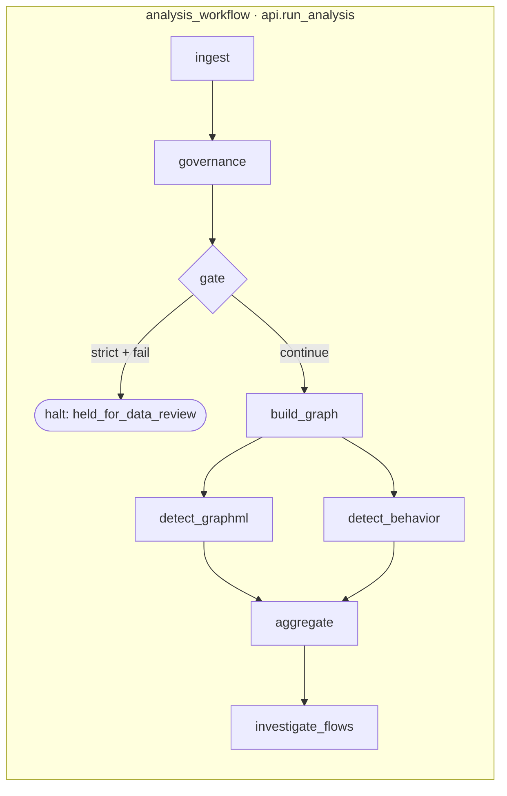
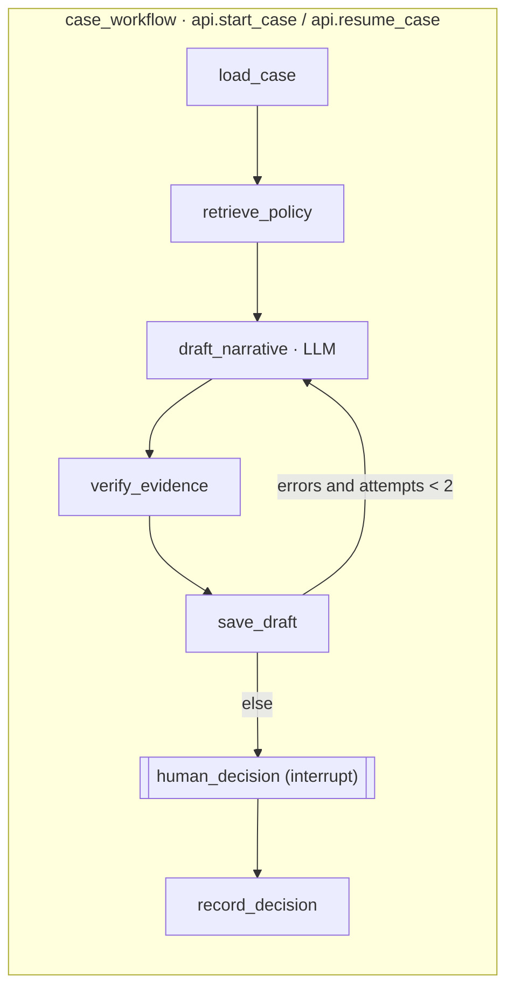
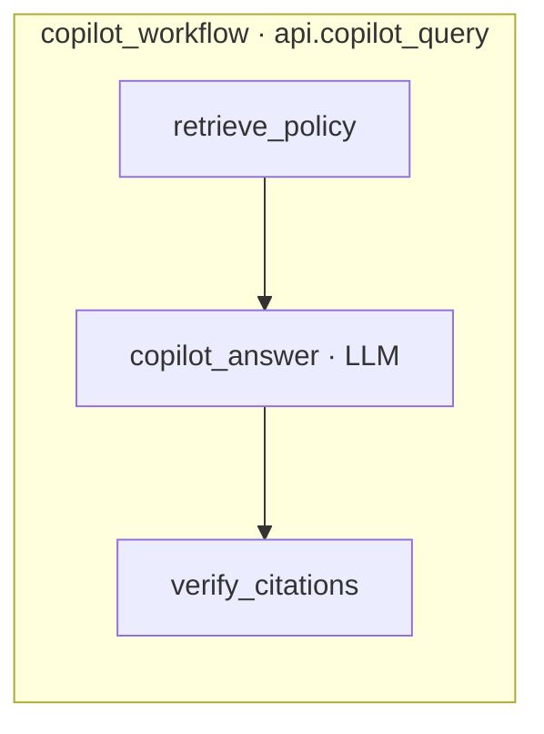

# TraceLayer agents: architecture

TraceLayer's agent layer turns a transaction batch into ranked, explained alerts and an evidence-grounded
case draft that a human decides on. It is three typed LangGraph workflows behind one facade
(`tracelayer_agents/api.py`). Only two nodes call an LLM, and every LLM output is checked by a
deterministic verifier before anyone sees it.

## Workflows







## Agents

| Node | Kind | Inputs | Outputs |
|---|---|---|---|
| ingest | deterministic | batch ref / file | ingestion_run_id, transaction_batch_id |
| governance | deterministic | batch (data contract) | governance_status pass/qualified/fail, quality_issues |
| build_graph | deterministic | batch | graph_snapshot_id, feature_schema_version |
| detect_graphml, detect_behavior | deterministic (ML models, run in parallel) | snapshot | per-detector scores, top factors, typology flags |
| aggregate | deterministic | detector outputs | ranked alerts: composite from `RankFusion` + every component score, tier, caveat |
| investigate_flows | deterministic (NetworkX) | top alerts | paths, cycles, fan-in/out, pass-through; hashed EvidenceBundle |
| load_case | deterministic | alert_id | alert, evidence bundle, derived facts (totals, counts, spans) |
| retrieve_policy | deterministic (RAG retriever) | alert / question | policy chunks with chunk_ids |
| draft_narrative | **LLM** (hybrid) | numbered fact claims, derived facts, source titles | NarrativeDraft: fact claims built in Python; LLM writes only summary, hypotheses, uncertainties, follow-ups |
| verify_evidence | deterministic | draft, bundle, sources | verifier errors, flagged claims, case_status |
| save_draft | deterministic | draft, verdict | persisted draft, audit events |
| human_decision | human | case packet | Decision (action, actor_role, non-empty reason) |
| record_decision | deterministic | decision | final case_status, `case.decision` audit event |
| copilot_answer | **LLM** | question, escaped source blocks | PolicyAnswer: claims each citing chunk_ids |
| verify_citations | deterministic | answer, sources | answer with unsupported claims dropped, verifier errors |

Every node returns a Pydantic model and is wrapped by `@traced_node`, which validates the output,
enforces a timeout and appends a trace event (node, timings, status, input/output hashes).

## Governance gate

A data-quality failure is a governance issue, never a risk signal. Any critical quality issue makes
the batch `fail`:

- **strict** stops the run before scoring: `case_status = held_for_data_review`, no alerts.
- **exploratory** scores anyway, but every alert carries `confidence_caveat = "incomplete_data"`
  (the schema rejects an alert on a failed gate without one).

## Evidence verifier and guardrails

The LLM never supplies facts. Amounts, totals, dates, IDs and graph patterns are computed in Python and
handed to it as numbered claims. Before a draft reaches the reviewer, `verify_evidence` checks it:

- every transaction ID, account ID, amount and date in a claim exists in the evidence bundle or its
  derived facts (`UNKNOWN_TX`, `UNKNOWN_ACCOUNT`, `UNSUPPORTED_AMOUNT`, `UNSUPPORTED_DATE`);
- fact claims cite transactions (`MISSING_EVIDENCE`); policy claims cite retrieved chunks (`BAD_CITATION`);
- free text (summary, uncertainties, questions) is swept for ungrounded IDs, amounts and dates (`UNGROUNDED_TOKEN`);
- prohibited language: crime or intent attribution and SAR status (`"SAR ready"`, `"committed fraud"`, `"to evade"`, …);
- hypotheses must include a legitimate explanation or a reviewer caveat (`MISSING_ALTERNATIVE`).

A failed draft is redrafted once with the errors as feedback. If errors remain, the draft is kept as
`needs_revision` with the claims flagged, and only a supervisor may dismiss it. The copilot drops any claim
that cites nothing or cites a chunk that was not retrieved, and it answers "no answer" rather than
answer without a source. Retrieved text is untrusted: it is HTML-escaped inside `<source>` blocks, and
the narrative prompt sees only source titles.

## Audit hash chain

Run start/finish, alert creation, draft generation, verification and the human decision each append
an event, where `hash = sha256(prev_hash + canonical_json(event))`. The repository rejects any event
that does not extend the current head. `api.verify_audit_chain()` re-hashes the whole chain and reports
the first bad index. Events record model versions, prompt_version, bundle_hash and the actor, but
never prompt text.

## Fallback chain

```
Ollama (qwen3.5:9b, local)  →  deterministic template  →  precomputed golden run (opt-in)
```

- **Ollama → template**: if Ollama is unreachable, times out (`LLM_TIMEOUT_S` covers the whole call), returns
  invalid JSON twice, or the per-run call budget is spent, the template answers. The result is the same
  schema with `fallback_used=true`. `LLM_PROVIDER=template` runs the demo with no network at all.
- **Precomputed**: `--golden --save` records a live Ollama run. With `TRACELAYER_PRECOMPUTED=1`,
  `start_case` and `copilot_query` serve that output instantly, but only for the golden alert and
  question. Results carry `precomputed=true` and the original provider, model and prompt_version, and the
  verifier, audit chain and human decision still run live. Every other request runs live.

## Limitations

- **Synthetic data only** (AMLSim-style fixtures). Nothing has been tested on real customer data.
- **Mocks until teammates' modules land.** Detectors, rank fusion, graph, quality rules and RAG
  are deterministic mocks behind the Protocols (`model_version="mock-0"`, fusion `mock_rank_mean`).
  The scores show how the pipeline works and are not a model evaluation.
- **In-memory stores.** Cases, audit chain and the paused-case checkpointer are lost on restart
  until the backend wires Postgres.
- **Not a compliance product.** The policy corpus is paraphrased mock excerpts plus fictional
  procedures, the guardrail phrase lists are starters, and the role rules are a placeholder for real RBAC.
- **No automatic filing or action.** Escalation is an internal status change. Nothing is filed, frozen
  or sent to a customer, and a person makes every decision.
